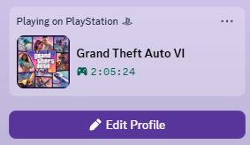
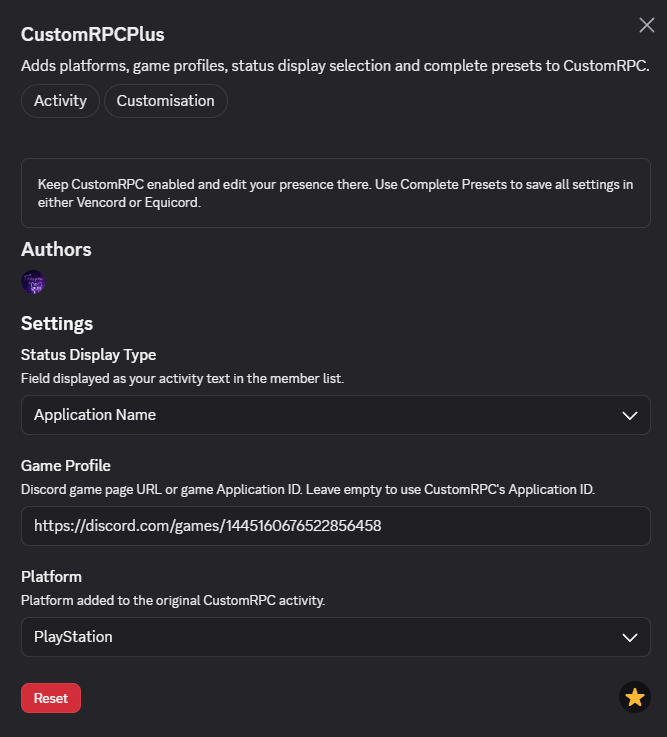
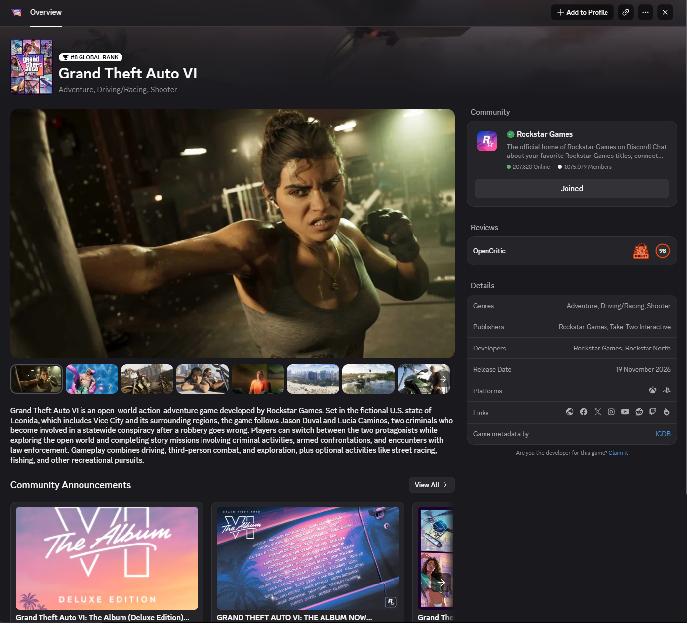

<div align="center">

# CustomRPCPlus

**Your CustomRPC, with console platforms, native game pages and presets that remember everything.**

[](https://github.com/Vendicated/Vencord)
[](https://github.com/Equicord/Equicord)
[](LICENSE)
[](#installation)



[Features](#what-plus-adds) · [Screenshots](#screenshots) · [Installation](#installation) · [Complete presets](#complete-presets) · [Compatibility](COMPATIBILITY.md)

</div>

## What is it?

CustomRPCPlus is a userplugin for **Vencord and Equicord** that extends the built-in **CustomRPC** plugin. Keep the editor you already know, then add a few things it does not expose: console platform labels, a real Discord game profile, a choice of status text, and complete presets shared by the same plugin code on both clients.

The original CustomRPC still builds and sends your presence. Plus augments that activity and its preview, so your existing names, details, images, buttons and party information stay useful. Both plugins should be enabled.

## What Plus adds

### PlayStation, Xbox or the classic look

Choose **Default**, **PlayStation** or **Xbox** without editing source code or rebuilding for every change.

- **Default** sends the activity without a platform override.
- **PlayStation** uses `ps5` for Discord's console platform presentation.
- **Xbox** uses `xbox`.

The same choice is applied to the live preview. The dropdown focuses on the console labels tested in this project, rather than listing platform values that do not produce a useful visible result.

### A real game page behind the activity icon

Paste a Discord game profile link or its numeric Application ID into **Game Profile**. Plus associates your activity with that game, allowing Discord's native game icon interaction to open its actual game page when the client supports it.

For example, the included screenshots use [Grand Theft Auto VI](https://discord.com/games/1445160676522856458). Its game page can show the game's artwork, description, screenshots, community and other metadata supplied by Discord.

This uses the game's activity identity. Viewers do not need CustomRPCPlus to use Discord's supported game page interaction. A game must have a real Discord game profile; an arbitrary name alone does not create one.

The current default is the GTA VI link shown in the screenshots. Replace it with another game, or clear the field to keep the original CustomRPC application identity.

### Your artwork comes first

- A configured **large image** stays yours.
- If the large image is empty, Plus tries to load the linked game's **Discord icon** automatically.
- A configured small image and tooltip are preserved.
- Existing external image references remain intact.
- Image asset IDs from your custom application retain their original artwork path when the linked game identity changes.
- If Discord has no game artwork available, the activity can continue without adding an image.

While Game Profile linking is active, custom image click URLs are omitted so they do not override native game page navigation. Your regular activity button URLs are kept. Clear Game Profile to restore the original image click URLs.

### Choose what appears in the member list

**Status Display Type** exposes `status_display_type` with three choices:

- **Application Name** — use the activity's name.
- **State** — use its State text.
- **Details** — use its Details text.

Use the standard activity title, a lobby label or the detail line as your status text. The selected value is included in both the outgoing presence and the preview.

### Complete presets on both clients

Plus includes its own **Complete Presets** panel, so full saving works in stock Vencord as well as Equicord. A saved preset includes:

- Application ID and name.
- Activity type, details, state and their URLs.
- Stream URL.
- Large and small image keys/URLs, tooltips and image click URLs.
- Both activity buttons and their URLs.
- Party size and maximum size.
- Timestamp mode, start time and end time.
- Enable Presence.
- Plus platform, Game Profile and Status Display Type.

Empty fields are saved too. Loading a preset restores the entire activity setup and updates the editor and preview, instead of leaving values from the previously selected setup behind.

### A repeating custom timer

Set both custom timestamps with **End greater than Start** to use their difference as a repeating duration. Stock Vencord gets this behavior from Plus; the customized Equicord build used for this project keeps its existing native loop.

Changing the platform or game profile does not reset the loop. Any timer started by Plus is cleaned up when the presence or add-on is disabled.

## Original CustomRPC features stay available

Continue using the built-in editor for **Playing, Streaming, Listening, Watching and Competing**, application names and IDs, details and state, clickable text links, large and small images, image tooltips, up to two URL buttons, party size and timestamp modes.

The original preview layout, activity sharing reminders and toolbox presence toggle remain available. Plus keeps the original activity sender and socket ID and does not rewrite the built-in CustomRPC source files.

## Screenshots

### The Plus settings

Platform, Game Profile and Status Display Type are available from the Plus settings and are also added to the original CustomRPC editor.



### Native Discord game profile

The game page shown after opening the linked game, captured by the project author:



Screenshots show the author's Discord client and example configuration. Game artwork and branding belong to their respective owners.

## Installation

This is a **source userplugin**. You need a source build of [Vencord](https://docs.vencord.dev/installing/custom-plugins/) or [Equicord](https://github.com/Equicord/Equicord).

From the root of your chosen client's source checkout:

```powershell
git clone https://github.com/freshcompet/CustomRPCPlus.git src/userplugins/CustomRPCPlus
pnpm install --frozen-lockfile
pnpm build
```

Alternatively, download the repository ZIP and place the **entire plugin folder** at:

```text
src/userplugins/CustomRPCPlus/index.tsx
src/userplugins/CustomRPCPlus/completePresets.tsx
src/userplugins/CustomRPCPlus/presets.ts
src/userplugins/CustomRPCPlus/timestampLoop.ts
```

Keep those files together. Do not copy only `index.tsx`, and avoid an extra nested folder such as `CustomRPCPlus/CustomRPCPlus/index.tsx`.

If this is your first source checkout, complete your client's normal source installation procedure. If your existing installation already uses this checkout, fully quit and restart Discord after rebuilding.

### First setup

1. Enable **CustomRPC** and **CustomRPCPlus**.
2. Open the original **CustomRPC** settings to edit your activity.
3. Choose Platform, Game Profile and Status Display Type.
4. Configure the original fields, or leave the large image empty to try the game artwork fallback.
5. Keep CustomRPC's **Enable Presence** and Discord's **Activity Sharing** enabled.
6. Use **Complete Presets** to save the whole setup.

CustomRPC may appear under **Required Plugins** with a locked toggle. That is expected: Plus depends on it and needs it to remain enabled.

## Complete presets

Use **Save Complete Preset**, **Load Complete Preset** and **Delete Complete Preset** in the Complete Presets section. Saving an existing name replaces that complete preset.

On first use, Plus copies compatible presets from the earlier CustomRPC and standalone Plus storage. The original records are kept. **Copy Existing Presets** can bring in additional legacy presets later; existing complete presets win when names match.

Older presets that did not store Plus fields use your current Plus choices when imported. Once saved as a complete preset, those choices are stored explicitly. Deleted complete presets stay deleted unless you choose to copy the legacy records again.

Equicord's older native preset controls remain supported. For the same full saving experience in either client, use **Complete Presets**.

## Updates and compatibility

One plugin source works with both clients. Verification includes **Vencord 1.15.19** and the author's **Equicord 1.15.18.2** checkout. See [COMPATIBILITY.md](COMPATIBILITY.md) for the exact revisions, build results and test scope.

The author has provided live Equicord screenshots of the console presence, Plus settings and native game page. Vencord has been checked through its real source, build, type checking and integration tests; a live Vencord client check is still recommended.

Discord controls which game pages, platform labels and activity elements a viewer sees. Native game profiles are a desktop feature, and rendering can change with Discord updates. Test visibility from another account when changing your setup.

Client updates that replace a custom build require rebuilding it with the userplugin again. Future client or Discord changes may require plugin maintenance.

To update an installation cloned from this repository:

```powershell
git -C src/userplugins/CustomRPCPlus pull
pnpm build
```

Then fully restart Discord.

## Development

Run from the Vencord or Equicord checkout containing the plugin:

```powershell
node --test src/userplugins/CustomRPCPlus/tests/addon.test.cjs
pnpm build --dev
```

Type checking: `pnpm test:ts` in Vencord, or `pnpm testTsc` in Equicord.

The integration tests bundle each client's real CustomRPC implementation with mocked Discord services. They cover activity identity, platform selection, status display, artwork preservation and fallback, preview updates, timer rollover, full preset restoration, migration and cleanup. The native Equicord preset test is skipped in stock Vencord.

## Author and upstream credits

**CustomRPCPlus** is maintained by [freshcompet](https://github.com/freshcompet), Discord account [`801514233010847784`](https://discord.com/users/801514233010847784).

Built on the original **CustomRPC** plugin from [Vencord](https://github.com/Vendicated/Vencord/tree/main/src/plugins/customRPC), also present in [Equicord](https://github.com/Equicord/Equicord/tree/main/src/plugins/customRPC). Original plugin credits include **captain, AutumnVN, nin0dev and c0nnorgg**. The original copyright and GPL notices are retained in the source and [NOTICE](NOTICE).

An independent userplugin; not an official Vencord, Equicord, Discord or Rockstar Games release.

## License

**GPL-3.0-or-later.** See [LICENSE](LICENSE).
